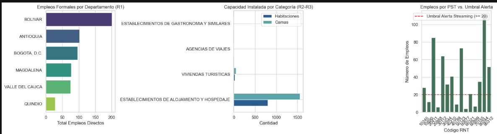
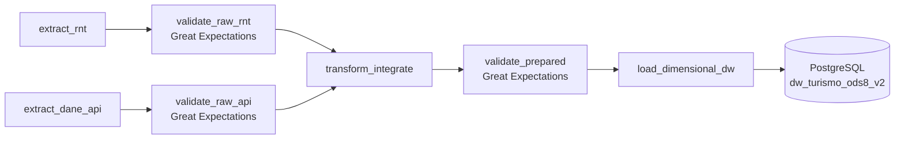
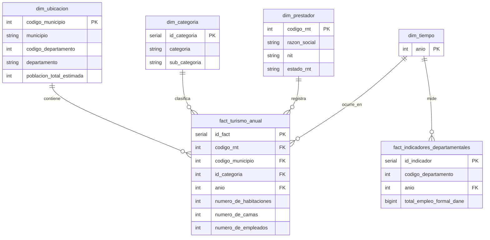
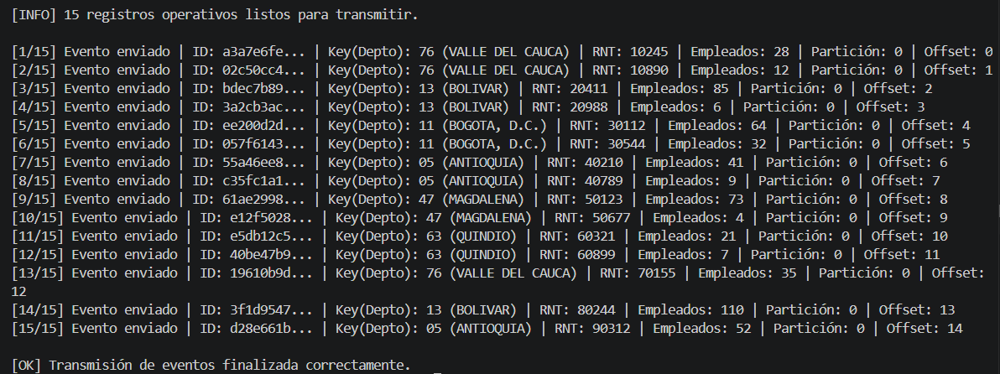
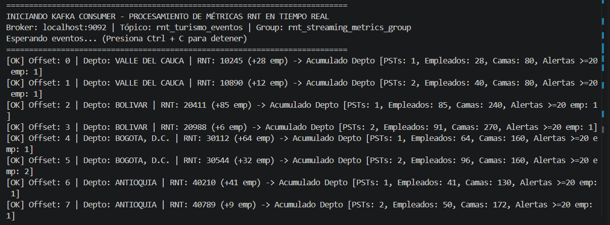
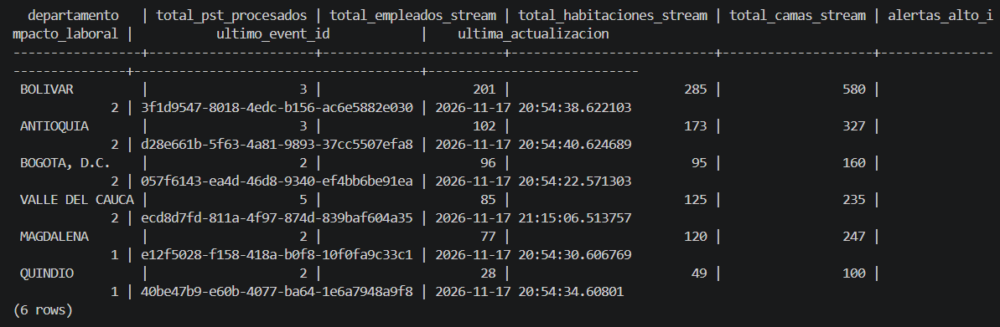
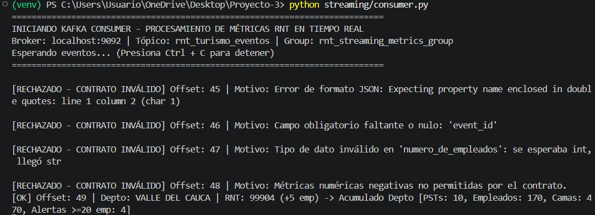
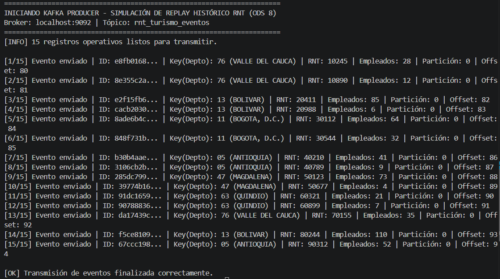
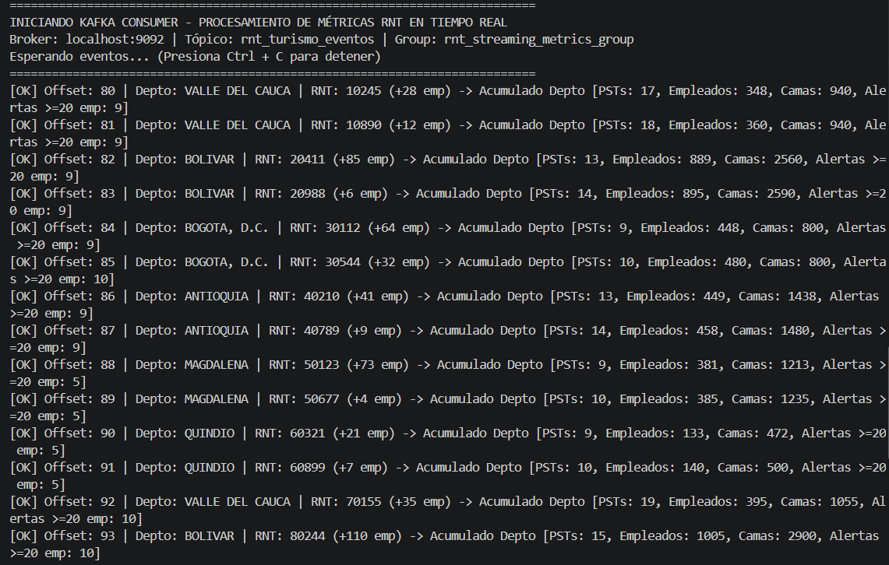
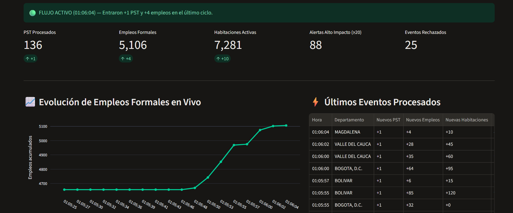

## 1. Projecto 3

### 1.1 Problema y Objetivo del Proyecto
Los datos del Registro Nacional de Turismo (RNT) y las estadísticas laborales del DANE se publican por separado y con distintos formatos, lo que dificulta medir el crecimiento turístico y la generación de empleo formal en Colombia (**ODS 8**).

**Objetivo:** Construir un pipeline híbrido (**Batch + Streaming**) automatizado y validado que integre los datos históricos (2019–2026) con eventos operativos en tiempo real, permitiendo analizar el impacto laboral e infraestructura del turismo en dos dashboards (histórico y en vivo).

### 1.2 Requerimientos del Sistema: Batch vs. Streaming

#### Capa Batch (Análisis Histórico — Airflow + PostgreSQL)
Resuelve las preguntas estratégicas que requieren cruzar años completos y datos demográficos del DANE[cite: 1, 2]:
* **R1:** Concentración territorial del empleo formal en el sector turístico.
* **R2:** Capacidad de alojamiento e infraestructura instalada por territorio.
* **R3:** Distribución de empleo e infraestructura según categoría comercial.
* **R4:** Densidad y tamaño promedio de empleabilidad por establecimiento.
* **R5:** Evolución temporal del registro de prestadores y dinamismo laboral (2019–2026).
* **R6:** Capacidad de alojamiento por habitante (Densidad Turística Municipal).
* **R7:** Impacto del empleo turístico en el mercado laboral regional.

#### Capa Streaming (Monitoreo en Tiempo Real — Kafka + PostgreSQL)
Justifica la baja latencia al permitir detectar cambios operativos al instante, sin esperar al cierre del proceso Batch diario o semanal[cite: 1]:
* **Actividad e infraestructura en vivo:** Conteo continuo de prestadores (PST), habitaciones y camas procesadas por departamento.
* **Empleo formal en tiempo real:** Acumulación inmediata de empleos directos reportados.
* **Alertas de alto impacto laboral:** Detección temprana por departamento de establecimientos que generan **20 o más empleos directos**.

---

## 2. Data Sources and EDA

### Fuentes de Datos
* **Registro Nacional de Turismo:** Información de prestadores turísticos activos en Colombia, incluyendo ubicación, categoría comercial, habitaciones, camas y empleos directos.
* **Datos DANE:** Indicadores poblacionales y del mercado laboral regional para medir densidad turística e impacto en el empleo.
* **Eventos en Tiempo Real:** Reportes operativos enviados mediante Apache Kafka y almacenados en PostgreSQL.

### Análisis Exploratorio
El análisis se realizó en el notebook `notebooks/eda_rnt_ods8.ipynb` sobre la base de datos del proyecto para revisar la distribución y calidad de la información:



### Hallazgos y Reglas de Calidad Aplicadas
Los resultados del análisis definieron las reglas de limpieza y validación del sistema:

* **Ceros válidos en capacidad física:** Categorías como agencias de viajes y gastronomía no tienen habitaciones ni camas, por lo que se aceptan valores mayores o iguales a cero y solo se rechazan números negativos.
* **Estándar en llaves de cruce:** Los códigos de municipio y categoría se validaron como enteros obligatorios para evitar pérdidas al cruzar las tablas del modelo estrella.
* **Regla de alerta laboral:** Al detectar prestadores que superan los 20 empleos directos, se fijó ese umbral en Kafka para generar alertas de alto impacto laboral.
* **Validación de mensajes en vivo:** Se establecieron campos obligatorios y tipos de datos estrictos para desviar registros con errores a una tabla de rechazo sin afectar las métricas en tiempo real.

---

### 2.2 Data Sources

Adicional a la ingesta batch histórica del Registro Nacional de Turismo (RNT) de Colombia, el sistema incorpora un flujo de eventos en tiempo real orientado al monitoreo continuo del **ODS 8 (Meta 8.9: Turismo sostenible y creación de empleo local)**.

* **Generación de eventos:** Los eventos se generan a partir de registros operativos verificados en la tabla de hechos del Data Warehouse (`fact_turismo_anual`), filtrando exclusivamente prestadores de servicios turísticos (PST) con actividad económica y laboral efectiva (`numero_de_empleados > 0` o `numero_de_habitaciones > 0`). Dado que el dataset abierto del RNT es de actualización periódica, el productor opera mediante una **simulación controlada de replay histórico** (`simulation_mode: "HISTORICAL_REPLAY_RNT"`), emitiendo actualizaciones individuales cada 2 segundos para emular la llegada continua de reportes de capacidad y empleo.
* **Justificación de baja latencia:** Procesar estas actualizaciones con baja latencia permite a las entidades territoriales y observatorios de turismo detectar en tiempo real cambios en la capacidad instalada (habitaciones y camas disponibles), identificar de inmediato establecimientos de alto impacto laboral ($\ge 20$ empleados formales directos) y generar alertas operativas por departamento sin esperar al cierre del ciclo batch diario o semanal.

---

### 4. Batch ETL Pipeline

El pipeline batch está orquestado con Apache Airflow y procesa dos fuentes:

| Fuente | Tipo | Mecanismo de extracción | Frecuencia |
| :--- | :--- | :--- | :--- |
| **Registro Nacional de Turismo (RNT, MinCIT)** | Dataset estático (CSV, 679.548 filas, corte 2026-09-15) | Lectura del snapshot `data/source/RNT_20260915.csv.gz` | Por lote, en cada ejecución del DAG |
| **Indicadores/población DANE** | Fuente externa (API / archivo DANE) | Llamada periódica; la respuesta cruda se conserva en `data/raw/api/<batch>` para trazabilidad | Por lote, en cada ejecución del DAG |

---

#### 4.1 Estructura del DAG

`dags/` contiene solo orquestación; la lógica vive en `src/etl/` (extracción, validación, transformación, carga), lo que permite probarla sin Airflow.



| Etapa | Qué hace | Si falla |
| :--- | :--- | :--- |
| **Extract** | Lee el CSV del RNT y consulta la fuente DANE; guarda el lote crudo con identificador de batch. | La tarea falla y el DAG se detiene; nada llega al DW. |
| **Validate raw (Gate 1 y 2)** | Suites GE sobre cada fuente cruda. | Reglas Critical → tarea en rojo y bloqueo de la rama. Warning → se registra y continúa. |
| **Transform / Integrate** | Limpieza e integración según el modelo dimensional (tabla 4.2). | Excepción → tarea fallida. |
| **Validate prepared (Gate 3)** | Suite GE sobre los datos ya integrados, antes de tocar el DW. | Reglas Critical → tarea en rojo y `load_dimensional_dw` queda en `upstream_failed`. |
| **Load** | Carga dimensiones y luego hechos en PostgreSQL, en una sola transacción. | Rollback: el DW conserva la versión anterior. |

---

#### 4.2 Transformaciones principales

Las transformaciones salen del EDA (ver sección 2 del README); cada una responde a un hallazgo medido sobre los datos reales.

| ID | Transformación | Hallazgo que la motiva |
| :--- | :--- | :--- |
| `T01b` | Reparación de mojibake en texto (`OCAÑA` → `OCAÑA`) | 10.577 filas de municipio y 44.407 de razón social afectadas |
| `T02a` | Normalización de enteros con punto de miles (`"1.008"` → `1008`) en `CODIGO_RNT` | Leídos como decimal y truncados, ~245.646 prestadores colapsaban en 428 |
| — | `zfill` de códigos DIVIPOLA (municipio 5 dígitos, departamento 2) | 137.360 filas con código de municipio de 4 dígitos (cero inicial perdido) |
| — | `strip` + `upper` en campos de texto; imputación `'NO REGISTRA'` en razón social nula | Duplicados artificiales y etiquetas vacías en dimensiones |
| — | Cuarentena de registros con municipio `(FUERA DEL PAIS)` (código `1`) | 22 filas sin ubicación nacional válida |
| — | Left join RNT ↔ población DANE por `(codigo_municipio, anio)`; población no encontrada → `0` | 7.034 de 7.097 pares municipio-año (99,1 %) encuentran población |

---

#### 4.3 Ejecución y programación

El DAG se puede lanzar manualmente desde la UI (`http://localhost:8080`) o por CLI (sección 10).

* **Programación:** `[PENDIENTE: indicar el schedule real, p. ej. @daily o @weekly]` con `catchup=False`.
* **Reintentos:** `[PENDIENTE: indicar retries / retry_delay configurados]`.

---

### 5. Data Quality

La validación usa Great Expectations (GX) en tres puntos del flujo (gates). Las reglas están catalogadas en `gx/` y documentadas en `docs/quality.md`.

#### 5.1 Compuertas

| Gate | Datos evaluados | Suite | Decisión |
| :--- | :--- | :--- | :--- |
| **1** | RNT crudo | `suite_rnt_raw` | Critical bloquea la rama del RNT |
| **2** | API/DANE cruda | `suite_dane_raw` | Critical bloquea la rama de la API |
| **3** | Datos integrados y preparados | `suite_dw_prepared` | Critical impide cualquier carga al DW |

#### 5.2 Reglas y severidad

| ID | Capa | Expectation GX | Severidad | Respuesta |
| :--- | :--- | :--- | :--- | :--- |
| `DQ-01` | RNT | `expect_column_values_to_be_between(numero_de_empleados, min_value=0)` | Critical | Bloquea |
| `DQ-02` | RNT | `expect_column_pair_values_A_to_be_greater_than_B(numero_de_camas, numero_de_habitaciones, or_equal=True)` | Warning | Registra y continúa (6.541 filas, 0,96 %) |
| `DQ-03` | Preparada | `expect_compound_columns_to_be_unique([codigo_rnt, anio])` | Critical | Bloquea (grano de la tabla de hechos) |
| `DQ-04` | API | `expect_column_value_lengths_to_equal(codigo_departamento, 2)` | Critical | Bloquea si persiste tras `zfill(2)` |
| `DQ-05` | API | `expect_column_values_to_be_between(tasa_desempleo / tasa_informalidad, 0, 100)` | Warning/High | Registra y continúa |
| `DQ-06` | Preparada | Integridad referencial hacia `dim_ubicacion` | Critical | Bloquea |
| `DQ-P04 / DQ-P06` | RNT | Vigilancia de la normalización de `CODIGO_RNT` (punto de miles) | Critical | Bloquea |
| `DQ-P07` | RNT | Vigilancia de mojibake en texto | Warning | Registra |

---

#### 5.3 Comportamiento ante un fallo crítico

* La tarea de validación lanza una excepción cuando una expectativa Critical no se cumple.
* En Airflow la tarea aparece en rojo (`failed`) y las tareas siguientes quedan en `upstream_failed`.
* `load_dimensional_dw` no se ejecuta, por lo que las tablas finales del DW no se modifican.
* El resultado de la validación (JSON de GX) queda guardado en `[PENDIENTE: ruta, p. ej. data/validation_results/<batch>.json]` y el detalle se ve en el log de la tarea.

Las fallas controladas se provocan con el parámetro `fault_injection` del DAG:

| Valor | Efecto | Resultado esperado |
| :--- | :--- | :--- |
| `primary_negative_employees` | Inyecta empleados negativos en el RNT | DQ-01 falla → carga bloqueada |
| `primary_drop_column` | Elimina una columna obligatoria del RNT | Falla de esquema → carga bloqueada |
| `api_null_keys` | Deja claves nulas en la API | Falla Critical → carga bloqueada |

---

### 6. Data Warehouse

Motor: PostgreSQL (puerto local `5433`), base `dw_turismo_ods8_v2`. Esquema DDL en `sql/create_dw_v2.sql`.

#### 6.1 Modelo dimensional (esquema en estrella, dos tablas de hechos)



| Tabla | Grano | Clave primaria |
| :--- | :--- | :--- |
| `fact_turismo_anual` | Foto anual de un prestador (PST) del RNT en un municipio y año | `id_fact` |
| `fact_indicadores_departamentales` | Indicadores DANE de un departamento en un año | `id_indicador` |
| `dim_ubicacion` | Un municipio (código DIVIPOLA), con población estimada | `codigo_municipio` |
| `dim_categoria` | Combinación única categoría/subcategoría | `id_categoria` (surrogate) |
| `dim_prestador` | Un prestador por `codigo_rnt` | `codigo_rnt` |
| `dim_tiempo` | Un año calendario (2019–2026) | `anio` |

---

#### 6.2 Estrategia de carga

* **Dimensiones primero:** (`dim_tiempo`, `dim_ubicacion`, `dim_categoria`, `dim_prestador`) y hechos después, para respetar las llaves foráneas.
* **Reemplazo atómico:** La carga completa corre en una transacción; si algo falla se hace rollback y el DW queda como estaba. Es idempotente: reejecutar el DAG con el mismo lote no duplica filas (Test C).
* **Solo datos validados:** La carga solo se ejecuta si el Gate 3 terminó sin fallas críticas.
* **Reconciliación posterior:** Se comparan los conteos aceptados contra los cargados (consultas en la sección 10.4).

---

#### 6.3 Tablas operativas para el componente Streaming

Para que el consumidor Kafka persista las métricas agregadas en tiempo real y audite los eventos rechazados desde el primer arranque, el script de inicialización crea ambas tablas vacías:

```sql
CREATE TABLE IF NOT EXISTS streaming_metrics (
    departamento VARCHAR(100) PRIMARY KEY,
    total_pst_procesados INTEGER NOT NULL DEFAULT 0,
    total_empleados_stream INTEGER NOT NULL DEFAULT 0,
    total_habitaciones_stream INTEGER NOT NULL DEFAULT 0,
    total_camas_stream INTEGER NOT NULL DEFAULT 0,
    alertas_alto_impacto_laboral INTEGER NOT NULL DEFAULT 0,
    ultima_actualizacion TIMESTAMP WITH TIME ZONE DEFAULT CURRENT_TIMESTAMP
);

CREATE TABLE IF NOT EXISTS streaming_invalid_events (
    id_error SERIAL PRIMARY KEY,
    payload_crudo TEXT,
    motivo_rechazo VARCHAR(255) NOT NULL,
    fecha_rechazo TIMESTAMP WITH TIME ZONE DEFAULT CURRENT_TIMESTAMP
);
```
---

### 7. Batch Analytical Dashboard

Tablero histórico conectado al Data Warehouse en PostgreSQL (`dw_turismo_ods8_v2`) para responder los requerimientos **R1–R7** (ODS 8):

- **KPIs:** Total de PST activos, empleos formales directos, capacidad instalada (habitaciones y camas), densidad turística municipal y participación sobre el empleo regional DANE.
- **Visualizaciones:** Ranking departamental de empleo y alojamiento (R1–R2), comparativa por categoría comercial (R3–R4) y serie histórica 2019–2026 cruzada con mercado laboral DANE (R5–R7).
- **Diferencia con tiempo real:** Analiza cortes históricos consolidados por lote en lugar de eventos individuales en vivo.

---

### 8. Streaming Pipeline

El componente de streaming está implementado en Python sobre **Apache Kafka** (modo KRaft) y persiste sus resultados agregados directamente en PostgreSQL (`dw_turismo_ods8_v2`).

#### 8.1 Configuración del Tópico y Estrategia de Particionado
* **Broker:** `localhost:9092` (Apache Kafka 3.7.0).
* **Tópico:** `rnt_turismo_eventos`.
* **Llave de particionado (`event_key`):** Código DANE del departamento (`codigo_departamento`, ej. `"76"` para Valle del Cauca, `"13"` para Bolívar). Esto garantiza que todos los eventos pertenecientes a un mismo departamento sean enrutados a la misma partición de Kafka, preservando el orden cronológico de actualización de sus métricas.

#### 8.2 Kafka Producer 
* Extrae registros operativos relevantes desde `fact_turismo_anual` cruzados con `dim_ubicacion` y `dim_categoria`.
* Evita publicar registros vacíos o redundantes sin impacto analítico.
* Serializa cada mensaje en formato JSON UTF-8 con confirmación de escritura en el broker (`acks="all"`).

#### 8.3 Contrato de Eventos (Event Contract) y Reglas de Validación
Todo evento publicado en `rnt_turismo_eventos` debe cumplir estrictamente la siguiente estructura y tipos de datos:

```json
{
  "event_id": "a3a7e6fe-1234-4abc-9def-567890abcdef",
  "event_timestamp": "2026-11-17T21:15:30.120450+00:00",
  "event_key": "76",
  "simulation_mode": "HISTORICAL_REPLAY_RNT",
  "codigo_rnt": 10245,
  "departamento": "VALLE DEL CAUCA",
  "municipio": "CALI",
  "categoria": "ESTABLECIMIENTOS DE ALOJAMIENTO Y HOSPEDAJE",
  "anio": 2025,
  "numero_de_habitaciones": 45,
  "numero_de_camas": 80,
  "numero_de_empleados": 28
}
```
---

El **Kafka Consumer (`streaming/consumer.py`)** ejecuta 5 reglas de validación antes de procesar cualquier mensaje:
1. **Integridad JSON:** El payload debe ser un objeto JSON válido decodificable en UTF-8.
2. **Campos obligatorios:** Presencia no nula de `event_id`, `event_timestamp`, `event_key`, `codigo_rnt`, `departamento`, `categoria`, `numero_de_habitaciones`, `numero_de_camas` y `numero_de_empleados`.
3. **Tipado estricto:** Validación de tipos (`str` para identificadores/texto, `int` estricto excluyendo booleanos para métricas numéricas y `codigo_rnt`).
4. **Estándar temporal:** `event_timestamp` debe cumplir el formato estándar **ISO-8601**.
5. **Reglas de dominio e idempotencia:** Valores numéricos $\ge 0$ (`codigo_rnt > 0`) y control de duplicados mediante registro en memoria de `event_id` procesados.

Los mensajes que incumplen el contrato son rechazados sin detener el servicio, registrados en la tabla de auditoría `streaming_invalid_events` y confirmados en offset para evitar bloqueos del consumidor.

#### 8.4 Métricas de Streaming 
Por cada evento válido, el consumidor ejecuta una actualización incremental (`UPSERT` vía `ON CONFLICT DO UPDATE`) en la tabla `streaming_metrics` de PostgreSQL, manteniendo 4 indicadores clave por departamento:
1. **`total_pst_procesados`:** Conteo acumulado de prestadores turísticos procesados en el flujo.
2. **`total_empleados_stream`:** Suma acumulada de empleos formales directos reportados (indicador directo ODS 8).
3. **`total_habitaciones_stream` y `total_camas_stream`:** Capacidad instalada hotelera/turística acumulada en tiempo real.
4. **`alertas_alto_impacto_laboral`:** Conteo de establecimientos procesados que generan $\ge 20$ empleos directos.

#### 8.5 Comportamiento ante Fallos y Limitaciones
* **Eventos inválidos:** Ante payloads corruptos, campos faltantes, tipos erróneos o valores negativos, el consumidor captura la excepción de contrato, persiste el detalle del error en `streaming_invalid_events` y continúa consumiendo los siguientes offsets sin interrupción.
* **Interrupción temporal del Consumer:** Al utilizar `enable_auto_commit=False` y confirmar el offset únicamente después de completar el `COMMIT` en PostgreSQL, si el consumidor se detiene temporalmente mientras el productor sigue publicando, los mensajes quedan retenidos de forma durable en el log de Kafka y son procesados automáticamente al reiniciar el consumidor.
* **Limitaciones conocidas:** La deduplicación por `event_id` se mantiene en memoria durante el ciclo de vida del proceso del consumidor; ante un reinicio completo del proceso, la idempotencia a nivel de fila dependería de persistir los `event_id` procesados en una tabla dedicada en PostgreSQL.

---

### 9. Real-Time Dashboard

Implementado en `dashboards/dashboard_streaming.py` con **Streamlit** y **Plotly**, consulta `streaming_metrics` y `streaming_invalid_events` en PostgreSQL (`localhost:5433`) con auto-refresco cada **2 segundos**:

- **Métricas y gráficas:** KPIs con delta en vivo (`+Δ`), curva temporal de empleos formales acumulados, bitácora de últimos eventos procesados, comparativa departamental y auditoría de eventos rechazados.
- **Diferencia con el dashboard batch:** Monitorea el flujo entrante con latencia de segundos para detectar alertas laborales ($\ge 20$ empleados) y fallos de contrato al instante.

---

### 10. Execution and Reproducibility

#### 10.1 Requisitos

* Docker y Docker Compose v2
* Python 3.10+ (solo para generar la clave Fernet y para pruebas locales)
* Puertos libres: `8080` (Airflow) y `5433` (PostgreSQL del DW)
* Al menos 8 GB de RAM disponibles para los contenedores

#### 10.2 Configuración

```bash
git clone <URL_DEL_REPOSITORIO>
cd <NOMBRE_DEL_REPOSITORIO>

# 1) Variables de entorno (NO subir .env a GitHub)
cp .env.example .env

# 2) Generar la clave Fernet de Airflow y pegarla en AIRFLOW__CORE__FERNET_KEY
python -c "from cryptography.fernet import Fernet; print(Fernet.generate_key().decode())"
```

Edita `.env` y define las credenciales de PostgreSQL y Airflow. Ningún usuario, contraseña o llave debe quedar escrito en el código ni en el repositorio.

**Datos de entrada**

* **RNT:** ya incluido en `data/source/RNT_20260915.csv.gz` (corte 2026-09-15, 679.548 filas).
* **Población DANE (R6):** `data/source/PPED-AreaMun-2018-2042_VP.xlsx`.
* **API DANE:** `[PENDIENTE: indicar URL/endpoint, parámetros y si requiere token (el token va en .env)]`.
* **Prueba de humo sin datos reales:** `python scripts/make_sample_data.py data/source/rnt_sample.csv`.

---

#### 10.3 Levantar los servicios

```bash
docker compose up -d --build
docker compose ps          # todos los servicios deben estar "running"/"healthy"
```

* **Airflow UI:** `http://localhost:8080`
* **PostgreSQL del DW:** `localhost:5433`

**Ejecutar el DAG**

```bash
# Desde la UI: activar el DAG y pulsar "Trigger"; o por CLI:
docker compose exec <servicio-airflow> airflow dags unpause <dag_id>
docker compose exec <servicio-airflow> airflow dags trigger <dag_id>
```

> `[PENDIENTE: reemplazar <servicio-airflow> y <dag_id> por los nombres reales de docker-compose.yaml y dags/.]`

**Pruebas de confiabilidad (genera la evidencia de la sección 11)**

```bash
scripts/run_reliability_tests.sh A       # Test A: ejecución exitosa
scripts/run_reliability_tests.sh B       # Test B: falla Critical controlada
scripts/run_reliability_tests.sh C       # Test C: reejecución (idempotencia)
scripts/run_reliability_tests.sh C_after # verificación posterior al Test C
```

**Sin Docker (solo desarrollo)**

```bash
pip install -r requirements-dev.txt
pytest tests
PYTHONPATH=src python tests/e2e_local.py
```

**Ejecución de Streaming y Dashboard en Tiempo Real**

```bash
streamlit run dashboards/dashboard_streaming.py   # Terminal 1: Dashboard en vivo
python streaming/consumer.py                      # Terminal 2: Consumidor Kafka
python streaming/producer.py                      # Terminal 3: Productor de eventos
python streaming/test_invalid_events.py           # Prueba de eventos inválidos
```

---

#### 10.4 Verificar el resultado

```bash
psql -h localhost -p 5433 -U <usuario> -d dw_turismo_ods8_v2
```

```sql
-- Conteos por tabla
SELECT 'dim_tiempo' AS tabla, COUNT(*) FROM dim_tiempo
UNION ALL SELECT 'dim_ubicacion', COUNT(*) FROM dim_ubicacion
UNION ALL SELECT 'dim_categoria', COUNT(*) FROM dim_categoria
UNION ALL SELECT 'dim_prestador', COUNT(*) FROM dim_prestador
UNION ALL SELECT 'fact_turismo_anual', COUNT(*) FROM fact_turismo_anual
UNION ALL SELECT 'fact_indicadores_departamentales', COUNT(*) FROM fact_indicadores_departamentales;

-- Sin hechos huérfanos (debe devolver 0 en cada fila)
SELECT COUNT(*) FROM fact_turismo_anual f LEFT JOIN dim_prestador  p ON f.codigo_rnt      = p.codigo_rnt      WHERE p.codigo_rnt      IS NULL;
SELECT COUNT(*) FROM fact_turismo_anual f LEFT JOIN dim_ubicacion  u ON f.codigo_municipio = u.codigo_municipio WHERE u.codigo_municipio IS NULL;
SELECT COUNT(*) FROM fact_turismo_anual f LEFT JOIN dim_categoria  c ON f.id_categoria     = c.id_categoria     WHERE c.id_categoria     IS NULL;

-- Grano: debe devolver 0 duplicados
SELECT codigo_rnt, anio, COUNT(*) FROM fact_turismo_anual GROUP BY 1,2 HAVING COUNT(*) > 1;

-- Reconciliación de la métrica principal
SELECT SUM(numero_de_empleados) FROM fact_turismo_anual;
```

* **Criterio de éxito:** `fact_turismo_anual` = 679.548 filas, 0 huérfanos, 0 duplicados en `(codigo_rnt, anio)`, DAG en verde, y el Test B deja el DW sin cambios.

#### 10.5 Detener y reiniciar

```bash
docker compose down        # detiene los servicios y conserva los datos
docker compose down -v     # además borra los volúmenes (reinicio limpio)
```

---

### 11. Functional Evidence (Componente Streaming)

#### 11.1 Ejecución en vivo: Kafka Producer 


#### 11.2 Ejecución en vivo: Kafka Consumer


#### 11.3 Actualización incremental de métricas en PostgreSQL 


#### 11.4 Experimento A: Detección y rechazo de eventos inválidos 


#### 11.5 Experimento B: Interrupción temporal y recuperación del Consumer
**1. Publicación de eventos en Kafka mientras el Consumer está fuera de línea (Offsets 80–94):**


**2. Reinicio del Consumer y recuperación automática de eventos retenidos sin pérdida de datos:**


---

### 11. Functional Evidence

#### 11.1 Airflow

| Evidencia | Qué debe verse | Archivo |
| :--- | :--- | :--- |
| DAG exitoso – Graph View | Todas las tareas en verde | `[PENDIENTE: docs/evidence/airflow_graph_success.png]` |
| DAG exitoso – Grid View | Ejecución completa con fecha y duración | `[PENDIENTE: docs/evidence/airflow_grid_success.png]` |
| Log de `load_dimensional_dw` | Mensajes de carga y conteos | `[PENDIENTE: docs/evidence/airflow_log_load.png]` |
| Falla controlada (Test B) | Tarea de validación en rojo y `load_dimensional_dw` en `upstream_failed` | `[PENDIENTE: docs/evidence/airflow_graph_failure.png]` |

#### 11.2 Great Expectations

| Evidencia | Qué debe verse | Archivo |
| :--- | :--- | :--- |
| Resultado exitoso (Test A) | Suites con `success: true` y estadísticas de cada regla | `[PENDIENTE: docs/evidence/ge_results_success.png]` |
| Resultado de falla (Test B) | Regla Critical con `success: false`, `unexpected_count` y la acción de bloqueo | `[PENDIENTE: docs/evidence/ge_results_failure.png]` |

#### 11.3 PostgreSQL

| Evidencia | Qué debe verse | Archivo |
| :--- | :--- | :--- |
| Tablas del DW | `\dt` mostrando 4 dimensiones y 2 tablas de hechos | `[PENDIENTE: docs/evidence/pg_tables.png]` |
| Conteos por tabla | Resultado de la consulta de la sección 10.4 | `[PENDIENTE: docs/evidence/pg_counts.png]` |
| Integridad | 0 huérfanos y 0 duplicados de grano | `[PENDIENTE: docs/evidence/pg_integrity.png]` |
| DW intacto tras el Test B | Mismos conteos antes y después de la falla | `[PENDIENTE: docs/evidence/pg_after_failure.png]` |
| Tabla vacía de streaming | `SELECT COUNT(*) FROM streaming_metrics;` → 0 antes de iniciar el consumidor | `[PENDIENTE: docs/evidence/pg_streaming_empty.png]` |

#### 11.4 Reconciliación de la carga

| Tabla | Filas aceptadas (origen) | Filas cargadas | Estado |
| :--- | :--- | :--- | :--- |
| `dim_tiempo` | `[PENDIENTE]` | `[PENDIENTE]` | `[PENDIENTE]` |
| `dim_ubicacion` | `[PENDIENTE]` | `[PENDIENTE]` | `[PENDIENTE]` |
| `dim_categoria` | `[PENDIENTE]` | `[PENDIENTE]` | `[PENDIENTE]` |
| `dim_prestador` | `[PENDIENTE]` | `[PENDIENTE]` | `[PENDIENTE]` |
| `fact_turismo_anual` | 679.548 | `[PENDIENTE]` | `[PENDIENTE]` |
| `fact_indicadores_departamentales` | `[PENDIENTE]` | `[PENDIENTE]` | `[PENDIENTE]` |

---

```markdown
#### 11.6 Dashboard en Tiempo Real (Streamlit)

```
---